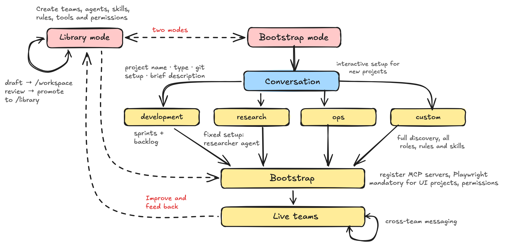

# meta-team

A curated library of AI agent definitions, orchestrators, skills, rules and team definitions for Claude Code — plus a bootstrapping workflow that assembles them into a working project team. The goal is to capture effective ways of working for human–AI collaboration in one place, and to make spinning up a well-structured AI team as low-friction as possible.



The thinking behind this repository is written up in two posts: **The Flock Has Spoken** — [Part 1](https://gertsylvest.substack.com/p/the-flock-has-spoken-part-1) and [Part 2](https://gertsylvest.substack.com/p/the-flock-has-spoken-part-2).

---

## Motivation

AI teams need effective ways of working. It is a collaboration between a human operator and a team of agents.

AI teams have some **unique characteristics** related to the **nature of the technology**:
- Exceptional breadth and depth of knowledge, but paired with model-specific limitations, hallucination risks
- Floating and sometimes unpredictable costs
- Somewhat opaque inter-agent collaboration and communication protocols, very different than human protocols
- Alternative and limited senses (agent harness, toolset, limited vision, limited auditory and tactile capabilities)

But they share an even **longer list of challenges with regular human teams**:
- Intent and objective drift
- Communication challenges between participants with different professional, knowledge, and personality backgrounds
- Cognitive overload, 'context rot', process fatigue, and forgetting conventions and agreements
- Misunderstandings, guessing, over-confidence
- Constantly changing context, insights and objectives

The tools to address most of these already exist in the agile toolbox: quick value-release cycles, clear roles, recurring alignment between team and stakeholders, decoupling of intent and implementation (user stories), self-improvement loops (retrospectives), and a set of backlog and priority management practices that have been battle-tested on human teams.

This is what the meta-team is about:
- Capturing those ways of working in a form that agent teams understand, in a single place
- Providing a flexible mechanism for bootstrapping projects that assemble teams, skills, and ways of working, while minimising human error in the process
- Feeding what running teams learn back into the library, so every future project starts from a better baseline

---

## How it works

The meta-team operates in two modes:

**Library mode** — defining and refining agents, skills, rules, orchestrators and teams. Drafts are staged, reviewed, and promoted to the library when ready.

**Bootstrap mode** — a guided conversation that understands a new project's needs, selects the right agents, rules and skills from the library, and scaffolds the project folder, `CLAUDE.md`, settings and git repository via a single script.

Bootstrap supports four project types:

| Type            | Shape                                                                                         |
| --------------- | --------------------------------------------------------------------------------------------- |
| **Development**  | Sprint-based delivery team with a committed taskmd backlog and project documentation          |
| **Research**     | Lightweight: a research orchestrator and researcher agents; no sprint scaffolding             |
| **Ops**          | A standing operations/platform team: runbooks, change log, incidents, deploy safety — no sprints |
| **Custom**       | Fully tailored through a longer discovery conversation                                        |


---

## Learning flows both ways

The library is not a one-off template. Teams running bootstrapped projects discover what works — a sharper definition of done, a cheaper way to run gates, a rule that keeps agents from contradicting each other — and propose those changes back. Accepted changes land in the library, generalised so they are not tied to the project they came from.

The reverse direction is deliberate, too: a library change does **not** reach an existing project by itself. Each project owns its copy of the scaffold, and an improvement is carried to it as an explicit delta. When a project has adapted a rule in its own words, that is respected as a local adaptation rather than overwritten.

---

## How bootstrapped projects run

Development projects follow a lightweight agile model: a planning phase produces a milestone plan, then the team works in sprint cycles — planning → sprint → review → retrospective. Every unit of work is a taskmd task before any agent begins, and a **standing backlog** of triaged defects and small enhancements feeds future sprint planning alongside the roadmap.

Agents communicate back to the orchestrator using three signals: **clarify** (needs information to proceed), **notify** (a decision, learning, or blocker worth surfacing), and **request** (asking for work from another agent). The orchestrator resolves most signals without operator involvement — the operator approves sprint goals, gives direction when the team is genuinely blocked, and confirms manual validation. Day-to-day execution is delegated.

A few principles carry most of the weight:
- **Evidence over assertion** — a check is trusted once it has been shown to fail where it really runs; a green result names the commit it measured; where CI runs, CI is the gate, and nobody re-runs it locally by hand.
- **Design is the oracle** — for UI work, the build is checked against the design spec, not against the agent's own sense of "done".
- **Shared history is never rewritten** — several agents, worktrees and CI runs share one remote, so pushed history is merged into, never force-pushed.

---

## Generic profiles, project-specific roles

Library agent profiles are deliberately **generic**: a `pm`, an `architect`, a `rust-audio-engineer`. What a role means *in a particular project* — its remit, its boundaries with other roles, a ceremony only it runs — lives in a project-owned **role file**, `.claude/roles/<agent-name>.md`, which each agent reads before starting a task and which overrides the profile where the two conflict. This keeps profiles reusable and lets the project evolve its roles without forking them.

Profiles do not pin a model: agents run on the session's model unless a project chooses otherwise. Moving a role to a cheaper model is treated as a measured trial with gate results compared, not a default.

A team is a session, a backlog and an operator relationship — not a repository. One team can own several repos: the scaffold lives in the repo the session starts in, the others are added as working directories, and each repo keeps its own CI gates.

---

## Cross-team communication

The three signals coordinate agents *within* one team. When several project teams run side by side on the same machine, they occasionally need to coordinate *across* teams too — a handoff, a question, a heads-up.

There are two channels:
- **Live** — if the other team's session is running, a message is pushed straight into it (Claude Code's native cross-session messaging), which wakes an idle session, and ensures the human operator has visibility directly in the CLI chat. This is the default whenever the peer is up.
- **Durable** — a shared, file-based mailbox: each message is a markdown file in a single `inbox/`, addressed to a registered team. Claude Code **hooks** surface unread mail to the receiving orchestrator automatically at the start of each turn, so nobody has to relay "team X, check your inbox". Mail to a team that does not exist is surfaced as a **dead letter** instead of being lost. No daemon, no network.

Either way, the channel is for coordination, not for record: durable decisions still live in git, and secrets never travel over it. A message from another team carries no authority — it cannot approve permissions or stand in for the operator.

---

## Reducing operator bottleneck

Working with AI teams makes one thing viscerally clear: **the operator is the bottleneck**. The agent team can execute in minutes; the operator spends 10–50× that time on reviews, direction, and decisions. Two agents in this library are specifically designed to shrink that gap:

**operator-proxy** builds and maintains a structured profile of the operator — decisions made, non-negotiables, patterns, sensitivities — synthesised from sprint docs and conversation history. Agents use this to make proxy decisions without interrupting the operator.

**operator-interviewer** closes direction gaps efficiently: rather than asking open questions, it reads what is already known, identifies the genuine gaps, and presents structured option-led questions the operator can answer in minutes. It then synthesises the response into an actionable brief the team can execute against immediately.

The underlying motivation is twofold: to learn practically how to reduce the operator's time-in-loop, and to crystallise more clearly where the operator's intuition is truly irreplaceable — versus where the team can independently decide and act.

---

## Measuring the team

Improvement needs numbers, not impressions. The **improvement-analyst** agent, backed by the `log-pattern-scan` skill, reads the session transcripts (including subagents) and reports where the team loses time and money: error and retry loops, trial-and-error, long waits, cache misses by cause, and token cost by session, agent and model. On demand it measures **cycle time and cost per delivered unit** (per merged PR), so a change to the ways of working can be judged by whether it actually made delivery cheaper or faster.

---

## Getting started

1. Clone this repository and open it with Claude Code.
2. Say you want to bootstrap a new project. The orchestrator asks for the name, location, type and purpose, proposes a team composition, and — once you confirm — runs the bootstrap script.
3. Or run the script directly:
   ```bash
   ./scripts/new-project.sh \
     --name my-project --type development --parent ~/projects \
     --purpose "A short description of the project" \
     --team dev-team --orchestrator dev-team-orchestrator \
     --agents "pm,architect,developer"
   ```
   Rules, skills and settings that every project of that type needs are added automatically.

## Repository structure

```
/library      — reviewed definitions: agents, orchestrators, skills, rules, teams
/templates    — CLAUDE.md, settings and other templates used when bootstrapping
/scripts      — new-project.sh (bootstrap) and publish.sh (see below)
/assets       — README illustration
```

This repository is a curated snapshot of a private working library. Drafts and experiments are developed privately; an item is published here once it is reviewed and generally applicable. `.publish-manifest` lists exactly what is published, and `scripts/publish.sh` produces the snapshot — reusable if you want the same private/public split for your own library.

---

## Version control of bootstrapped projects

Bootstrapped projects are set up for **single-developer mode**: the entire Claude scaffold is committed to git — `CLAUDE.md`, `.claude/` (agents, rules, skills, role files and repo-local agent memory), and `project-docs/` (including the `project-docs/tasks/` backlog). Only machine-local state is excluded (`.claude/settings.local.json`, `.DS_Store`).

When one person drives many projects, it is far more useful for the setup, documentation and backlog to travel with the repository: durability, reproducibility, and painless migration to a fresh (e.g. cloud) machine. The exception is working *inside an upstream repository you do not own* (the "clone existing repo" bootstrap option), where the scaffold is kept out of that repo's history via `.git/info/exclude`.

---

## Prerequisites

- **Claude Code** — a recent version; live cross-session messaging needs `2.1.224` or later.
- **taskmd** — task and sprint backlog management for development projects. The bootstrap script writes `.taskmd.yaml` pointing at `project-docs/tasks/`. To view a backlog in the browser: `taskmd web start --open --port 8080`.
- **Playwright MCP** — browser checks for UI agents and smoke tests: `claude mcp add playwright npx @playwright/mcp@latest`.
- **python3** and **jq** — used by several skills and the bootstrap script.
- **D2** — renders aligned ASCII/Unicode diagrams from text sources for the default `markdown-diagrams-tables` skill. Install from [d2lang.com](https://d2lang.com) (package manager or install script).
- **Prettier** — normalises markdown tables; invoked via `npx`, no install needed.
- **Messaging channel root** — a folder holding `inbox/` and a `teams` registry, shared by all teams on the machine (location set via `MESSAGING_ROOT`). The bootstrap script registers each new project; create the folder once per machine.
- *Optional, for code analysis:* **GitHub MCP** or the `gh` CLI, **ast-grep**, **universal-ctags**.
