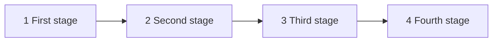

# Markdown diagrams & tables — generate, never hand-draw

> **Why this exists.** Hand-drawn ASCII boxes drift the moment any label changes length, and
> hand-typed pipe tables silently break rendering. Both are recurring, avoidable. The rule is
> simple: **a tool emits the diagram and normalizes the table — a human never aligns characters by hand.**

## The standard (what every agent MUST follow)

1. **Diagrams are generated, not typed.** Any box/flow/sequence diagram in a markdown doc
   is produced by a tool from a committed text source. You may **never** hand-edit the box
   characters of a generated diagram — edit the source and regenerate.
2. **Author picks the form per diagram** — ASCII (default, terminal-readable) or Mermaid (rendered
   on GitHub/GitLab/Claude artifacts). This is a per-diagram judgement about what best expresses
   the idea; it is **not** dictated by doc type or section. Neither form is forced.
3. **Tables are normalized by Prettier**, not aligned by hand. Prettier also *validates* — a table
   that Prettier reformats cleanly is a table that renders.
4. **Commit the source** for every generated ASCII diagram (the `.d2` file) beside the doc, so the
   next edit regenerates instead of re-drawing.

## Tooling (project dependencies)

| Need | Tool | Invocation |
|---|---|---|
| Align & fix tables + markdown | Prettier 3 (via `npx`, no global install; pinned to major 3 so formatting stays stable) | `npx --yes prettier@3 --write <files.md>` |
| Generate ASCII / Unicode diagrams | D2 (v0.7.1+, on `PATH` or in `~/.local/bin`) | see below |
| Rendered diagram inline | Mermaid | ` ```mermaid ` fenced block (no tool needed) |

If `d2` is missing on a machine, install it any of these ways:

- **Homebrew** (macOS or Linux): `brew install d2`
- **Prebuilt release binary**: download the archive for your OS/arch from
  https://github.com/terrastruct/d2/releases and put `d2` on your `PATH`.
- **Install script, user-local** (no sudo): `curl -fsSL https://d2lang.com/install.sh | sh -s -- --prefix "$HOME/.local"`,
  then ensure `export PATH="$HOME/.local/bin:$PATH"`. Read the script first if your policy requires it.

## Tables & markdown — Prettier

Run after editing any doc with tables (safe on prose too — it only normalizes formatting):

```bash
npx --yes prettier@3 --write path/to/doc.md
# check-only (CI / pre-close), non-zero exit if unformatted — scope it to the doc folders
# (a bare "**/*.md" also sweeps node_modules/, vendored deps and generated files):
npx --yes prettier@3 --check --no-error-on-unmatched-pattern "project-docs/**/*.md" "documentation/**/*.md" README.md
```

Prettier pads every column to the widest cell and rewrites the separator row, so ragged or
malformed pipe tables become aligned, valid tables.

## Diagrams — D2 (generated ASCII)

**Workflow:** write a `.d2` source → generate ASCII → paste the output into a fenced block in the doc.

1. **Author the source** in a `diagrams/` folder beside the doc, e.g.
   `<doc-folder>/diagrams/pipeline.d2`:

   ```d2
   direction: right
   s1: "1. First stage"
   s2: "2. Second stage"
   s3: "3. Third stage"
   s4: "4. Fourth stage"
   s1 -> s2 -> s3 -> s4
   ```

   **Keep every label on one line — no `\n` inside a label** (the ASCII renderer garbles
   multi-line labels). Use `direction: right|down|left|up`. Edges: `a -> b`, labelled `a -> b: "text"`.

2. **Generate** — pure ASCII (portable, `+ - |`) or extended (Unicode box chars `┌ ─ │`):

   ```bash
   D2="${D2:-$(command -v d2 || echo "$HOME/.local/bin/d2")}"
   # pure ASCII to stdout:
   "$D2" --ascii-mode standard --stdout-format ascii diagrams/pipeline.d2 -
   # Unicode box chars to a file:
   "$D2" --ascii-mode extended diagrams/pipeline.d2 diagrams/pipeline.txt
   ```

3. **Paste** the generated text verbatim into a plain fenced block in the doc:

   <pre>
   ```
   +----------------+  +-----------------+  +----------------+  ...
   |1. First stage  |->|2. Second stage  |->|3. Third stage  |  ...
   +----------------+  +-----------------+  +----------------+  ...
   ```
   </pre>

   Add a one-line comment above the block pointing at the source, e.g.
   `<!-- generated from diagrams/pipeline.d2 — edit source & regenerate, do not hand-edit -->`.

D2 handles branching/vertical layouts (`direction: down`, multiple edges, back-edges for
"rejected → fail closed") and keeps everything aligned automatically.

## Diagrams — Mermaid (rendered)

When a rendered diagram serves better (complex graphs, docs mainly read on GitHub / in artifacts),
use an inline Mermaid block — no external tool, GitHub and Claude artifacts render it natively:



Mermaid needs no alignment (the renderer lays it out) so it is never "broken" the way hand ASCII is;
the trade-off is it only looks like a diagram where a Mermaid renderer runs.

## Quick checklist before saving a doc

- [ ] Every ASCII diagram came from a committed `.d2` source (not hand-typed / hand-patched).
- [ ] Ran `npx --yes prettier@3 --write <doc>` so tables are aligned and valid.
- [ ] Long labels stay on one line in `.d2` sources.
- [ ] Generated blocks carry the "generated from … do not hand-edit" comment.
